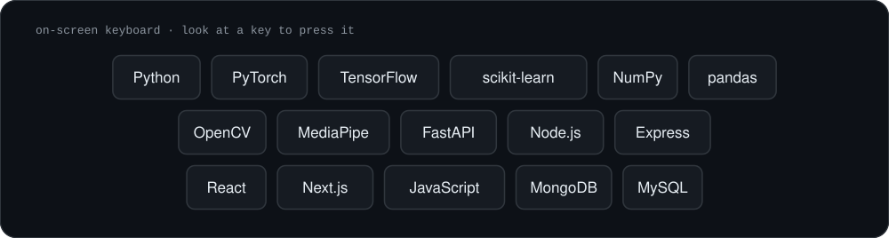
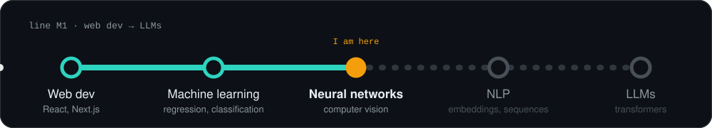

  

### Things I built

| Project | Input | What it does |
|---|---|---|
| **[Pogled Assist](https://github.com/Hasan-Smajlovic/Pogled-Assist)** | eyes | Move the mouse, click and speak Bosnian with a Tobii eye tracker. The banner above is based on it. |
| **[Gesture OS](https://github.com/Hasan-Smajlovic/motion-based-gestures-controlling-os)** | hands | A webcam and a PyTorch model turn hand gestures into desktop actions. |
| **[Voice Isolator](https://github.com/Hasan-Smajlovic/voice-isolator)** | voice | Removes music and noise from a video and keeps only the voice. Runs locally. |
| **[Sign Language Detector](https://github.com/Hasan-Smajlovic/sign-language-detector)** | hands | Reads hand signs from a webcam. |
| **[Smart Attendance](https://github.com/Hasan-Smajlovic/smart-attendance-system)** | RFID card | Check in and check out at work. Face verification comes next. |
| **[Moj Džemat](https://github.com/TajibSmajlovic/moj-dzemat)** | browser | Community site with posts, announcements and an admin panel. Team project. |
| **[Bella Vita](https://github.com/Hasan-Smajlovic/bazen-bella-vita)** | browser | Website for a pool and apartment complex. Freelance. |

### Tech

  

### Courses

  

